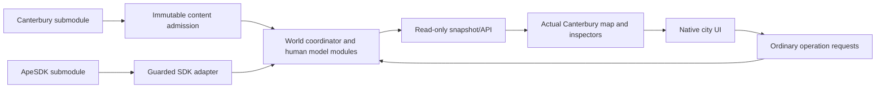

# Standalone human-city architecture

Cycle 02, 8 November 2026. This is the design and public declaration contract.
Cycle 03 adds a separately scoped native bootstrap CLI/app; Cycle 05 implements
its native clock/session lifecycle and derived 1940 calendar view. Cycle 06 adds
live person records, world-scoped stable references and native binding operations
(`docs/IDENTITY.md`). Cycle 07 adds checked heap ownership, prepared resource
publication and deterministic city RNG domains (`docs/MEMORY.md`). Cycle 08
adds a separate offline content compiler and versioned candidate bundle
(`docs/CONTENT.md`). Cycles 09–13 implement immutable runtime content admission,
a native-backed world coordinator, geometry/access, movement/routing and explicit
synthetic civil/household models. `src/cd_city.h` supplies the current supplemental
interfaces. The core API now implements world/content/snapshot and MOVE/node
operations; general operations and save/load remain reserved for later cycles.
Syntax-only Cycle 02 checks still do not qualify runtime behavior. The visual app
uses `CitySession` to serialize all native work off the AppKit thread.

## Names, layout and dependency boundary

Product: **Canterbury Details**. Proposed CLI: `CanterburyDetails`. Project C
functions use `cd_`; types use `Cd`; constants use `CD_`. No special actor kind is
needed: every admitted person is human. Use `src/` for the model/CLI, `ui/` for the
native app, `content/` for schemas/policies/manifests, `tools/` for offline generators
and checks, `tests/` for future runtime fixtures, `docs/` for local documentation,
and ignored `build/` for reproducible outputs. Build/toolchain definitions are
implemented in Cycle 03, including the requested 27,000-person default/admission.
Broader capacity/lifecycle qualification remains Cycle 04.

`content/architecture.json` is the machine-readable dependency and field-ownership
contract. Its upstream nodes are exactly `canterbury/` and `apesdk/`. Project
module paths marked `planned` intentionally do not exist yet. The reference-code
review ledger is historical provenance, not a third build dependency. No tool in
this repository opens the reference checkout to validate the architecture.

The diagram shows runtime information flow, including user feedback. Compile-time
module dependencies form the acyclic graph in `architecture.json`. Peer modules
exchange coordinator-provided read-only views/intents rather than including each
other's private state. The coordinator alone orders cross-owner transactions.
The UI, renderer and snapshot consumers use the public API and cannot mutate
native/project arrays directly.

## Public C interface

`src/cd_api.h` is self-contained C11, with C++ linkage support and no SDK struct
layout exposed. It requires both `CANTERBURY_SIM=1` and the current bridge's
`BRONZE_SIM=1`. All future runtime translation units must use the same flags.

- `CdContent` admits immutable, source-qualified data; it outlives its worlds and
  snapshots. Imported policies and review flags are explicit inputs, not globals
  borrowed from an earlier application.
- `CdWorld` owns the ordinary city model and backend session lifetime. Open/load
  publishes a complete valid world or preserves the previous one. Close releases
  project state, registries and borrowed native bindings in the documented order.
- `cd_world_step` delegates requested minutes to native `sim_cycle`. Clock views
  expose native elapsed time plus a deterministic civil-origin mapping. There is
  no wall-clock-driven authoritative mutation or independent needs/work clock.
- Preview is const/read-only: quantities/times are estimates, not reservations.
  Submit validates ordinary actor/target/operator policy and reserves once;
  cancellation releases only uncommitted reservations. Requests include world-
  qualified person references, deadlines and typed targets.
- Snapshots contain copied/derived human and institution views. Their strings are
  borrowed for snapshot lifetime; they never expose native body pointers. An index
  is only an enumeration cursor, not an actor identity. Person enumeration may
  include retained retired records; native living totals are a separate derived
  measure, not the size of that history array.
- Digest, inspection and capture consume no simulation RNG or minutes. Save/load
  coordinates all owners in a new standalone schema, with no old-game checkpoint
  aliases or special location/rest conditions.

The initial operation catalogue is move, assign job, deliver, repair, dispatch an
ordinary service, and set a qualified closure. These are design contracts for
later cycles, not advertised executable operations. Unsupported operations return
`CD_UNSUPPORTED`; no placeholder is allowed to report a fabricated success.
Errors use `CdStatus` and caller-owned `CdDiagnostic` storage.

## Identity, time, space and energy

Native ApeSDK bodies remain the sole physical population. Bronze actor IDs and
native-slot mappings resolve bodies; project records supply human semantics.
`CdPersonRef` adds a runtime world token to the person ID. Replacing/resetting or
loading a world changes that token and invalidates old borrowed references.
Tokens are runtime namespaces, not persisted process pointers or simulation RNG.
Persistent references use the checkpoint's world identity and stable IDs; restore
validates them and issues fresh runtime borrows.

A dead person's historical record can remain after native compaction. Life-record
retirement and native population removal commit as one lifecycle transaction.
Native slot count is not a second demographic population. Derived living totals,
occupancy indexes and ID lookup caches are reconciled against their owning data.

Route progress is a movement intention; a snapshot's `position` is a readout of
the native body. Neither is an independent physical coordinate. The same applies
to energy: meals/rest/care request bounded changes to the one native energy field,
and native work grants charge their cost through the shared budget. No separate
human energy/blood-like pool is introduced.

## Authoritative field owners

The JSON contract lists every currently planned authoritative field group, once.
This is a field-group inventory, not a serialized struct ABI. Future fields must
be added with an owner before implementation. Read-only copies are not extra
owners; validated indexes/caches must be reconstructible.

| Owner | Authoritative state / responsibility |
| --- | --- |
| Immutable content | Source IDs, rings/topology, qualifications, source institution/occupation/calendar definitions, technical policies and fingerprints |
| ApeSDK | Native body traits/position/energy, actor identity, live native slots, elapsed clock and native work grants |
| SDK adapter | Runtime handles/activation/world tokens/borrow generations; no serialized pointers |
| World coordinator | Scenario binding, deterministic RNG streams, transaction barriers and checkpoint generation |
| Person lifecycle | Civil identity, birth/life record, residence, household membership and guardians/spouses |
| Housing | Dwelling assignment, ordinary ownership and housing reservations |
| Movement | Route intentions/progress, ordinary door access state and qualified closures |
| Needs / health | Fatigue, meals, sleep/care intentions, ordinary illness/injury/recovery records |
| Employment | Jobs, contracts, skills, mentors and shifts; person employment views are derived joins |
| Work arbitration | Work intentions and completion-commit records, consuming native grants |
| Conserved resources | Stocks, household provision, money and transfers, with unique custody |
| Development | Worksites, materials and committed capacity/use changes; source geometry stays immutable |
| Institutions | Explicit membership, ordinary office holders, operational status, service commitments and gatherings |
| Civic services / logistics | Rosters/equipment/dispatch; vehicles, cargo/passenger custody and loading |
| Environment | Ordinary weather/fire/disruption and explicit scenario alerts |
| Causal records | Event sequence, ordinary observations, provenance and document copies |
| Operations | Bounded request queue, reservation/status/cancel records |
| Checkpoint codec | Coordinates serialization/staging; owns no duplicate model fields |
| Snapshot, renderer, UI | Derived views, camera, selection and display preferences only |

Person household membership is the canonical relationship; housing membership
lists are maintained indexes, validated/rebuilt during admission/load. The JSON
contract records the maintained lists separately as derived caches, not fields
with a second authoritative owner. Jobs own
assignments; institution staffing and person job views join those records. Resource
reservations are separate encumbrances, not duplicate goods. Their sum must never
exceed the owning stock, slot, money or work capacity.

## Mutation and lifecycle ordering

All mutations occur on one serialized simulation boundary. The adapter opens the
native interval and resolves the active registry. The world maps the calendar,
processes admitted requests and urgent needs/care, chooses ordinary travel/work
intentions, integrates movement once, and consumes stationary work grants once.
Completion effects, goods, staff changes and lifecycle cleanup commit in stable
order, followed by ordinary observation/event delivery. The SDK closes the budget;
inspection/rendering can then consume snapshots. Define exact hook ordering in
Cycle 05 against the actual pinned callback, never an invented parallel scheduler.

No component privately advances another owner's timer. Source generation, paused
UI navigation and estimates are read-only. Failure before publication destroys
staging state and restores active native bindings. Shutdown cancels/releases
project borrows before native cleanup. Multiple saved worlds may exist, but only
the matching active native snapshot can resolve a body pointer.

## Religion as ordinary human institutions

Keep affiliation, institution religion, denomination, worship status, staff roles,
location confidence and explicit scenario overrides distinct. No spatial inference
of personal affiliation or morality is permitted. Source active/closed/unknown
statuses do not manufacture staff, funds, attendees or verified historical dates.
The upstream Old Synagogue override stays identified as a scenario choice.

Clergy, custodians, teachers and charitable/voluntary workers use ordinary job
capacity, qualification, schedules and resources. Institutions can provide
supported gatherings, education, care, meals, maintenance and burial administration.
Access is ordinary residence/employment/opening/emergency policy. There is no
sanctity field, magical protection multiplier, consecrated movement barrier or
faith-corruption progression. Empty houses and vacancies use human housing policy;
no inherited supernatural threshold-fade rule is imported.

## Reuse and SDK extension boundary

`content/reuse-ledger.json` and `docs/REUSE.md` review the reference implementation
by file and recorded content hash. No implementation text is copied in Cycle 02.
The new public declaration header is project-local. Reuse is selective and all
later code must live here, with its original notices and a local acceptance test.
Mixed old modules are not accepted merely by renaming their prefix.

The current adapter uses existing guarded clock, ID, work and draw facilities.
No SDK changes are needed for this design cycle. If later cycles require changes,
put declarations, storage, bounds and call sites entirely behind
`CANTERBURY_SIM`. Ordinary native/Bronze builds retain their behavior/layouts.
Generic city data stays project-owned; do not expand Bronze fixture arrays into a
second parallel city or place thousands of records on the stack.

## Verification and current limitations

Run `python3 tools/verify_cycle02.py --run` to check the dependency graph, unique
field owners, public header syntax and profile rejection, reuse inventory and
absence of forbidden implementation symbols/sibling includes in owned source.
`--check` verifies recorded evidence matches current design inputs. The checker
opens only local project/submodule files and uses installed C/C++ compilers.
Cycle 01 source/pin checks remain independent and continue to pass.

Implementation, linkage, build entry points, memory, actor admission, runtime
behavior, save formats and native UI acceptance remain future cycle exits. This
architecture qualification does not substitute for those tests or resolve the
historical/licensing uncertainties already recorded in Cycle 01.

## Reusable foundation and visual client

The post-cycle-40 objective is to reuse this neutral core for the later game;
`docs/REUSE-FOUNDATION.md` defines the frontend/policy/save/RNG boundaries and
release-consumer acceptance gates. Supernatural semantics stay outside the base.

The current visual client is split into `CityApp.m` (native model controls and
inspectors) and `CityMap.m` (json2png image presentation, viewport and source-record
selection). Rendering/selection never owns native time or person position. Both
Make and the native Xcode project use `tools/native_sources.py` for source parity.
The exact upstream `json2png.c` runs at build time and its result is bundled; no
sibling application or screenshot is used as a runtime dependency. Visual picking
is source inspection, not qualified physical access or routing.

Cycles 14–18 add `cd_human.h`: bounded native-backed admissions/retirement,
ordinary needs, finite food, explicit health experiments and an immutable audited
role catalogue. Their orchestration runs only in the native callback and commits
mortality at each closed native minute. The SDK retains position/energy/time/ID
authority; city modules retain their own ordinary records. Employment assignment
and generic work are implemented in Cycles 19–20; persistence remains its later cycle.

## Cycles 19–23

`cd_work.h` is the neutral employment/economy/development/institution API. World
preallocation owns bounded records; worker callbacks use the one Bronze grant.
Source content is immutable; premises changes are scenario overlays.
`cd_work_digest.c` hashes logical state explicitly, never pointer values or padding.
See EMPLOYMENT, WORK, ECONOMY, DEVELOPMENT and INSTITUTIONS for contracts.

## Cycles 24–28

`cd_civic.h` declares neutral office/calendar/service/transport/environment APIs.
World construction preallocates all bounded records. The native minute applies
pressures, needs, office succession and civic/transport intentions before movement;
real grants then resolve care, transport loading, service/attendance, food, trade
and productive work. All records join stable actor/job/source IDs. Passive carried
people retain their one native body; vehicle custody blocks independent action.
`cd_civic_digest.c` hashes logical fields without padding or pointers. Calendar
component serialization is explicitly distinct from the Cycle 31 whole-city save.
The native UI receives copied civic summaries and resident custody/service facts.
