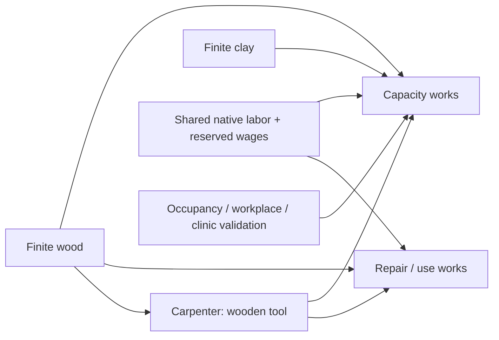

# Finite economy — Cycle 21

Wood, clay, fiber, tools, pots and textiles are abstract model units. Raw food and
prepared meals use the existing food ledger. Prices and money are **technical
model tokens**, not reconstructed historical pounds or prices. Imports require a
basis. Nothing replenishes automatically. Person, household and employer cash
accounts are separate from physical inventories and legal property ownership.
Money transfers move financial rights; goods require actual co-located work.

| Recipe | Qualified role | Inputs per unit | Output | Native minutes |
|---|---|---|---|---|
| Meal | Brewer / food skill | 1 raw food | 1 meal | 2 |
| Pot | Potter / craft | 1 wood + 2 clay | 1 pot | 3 |
| Textile | Weaver / craft | 2 fiber | 1 textile | 4 |
| Wooden tool | Carpenter / craft | 2 wood | 1 tool | 3 |
| Ordinary service | Clergy or lay caretaker | labor | 1 service count | 2 |
| Project labor | Carpenter / craft | separately reserved project materials | 1 project minute | 1 |

These yields and durations are disclosed scenario assumptions using source/SDK
occupation and goods concepts. Services confer no supernatural or medical effect.
Wood→tool→repair/capacity works provides a finite production/development chain.
Input shortages reject work before any partial reservation; replenishment permits
retry. Output capacity shortages pause completed effort before its last grant.

Household purchases reserve quoted payment and seller stock, then need a capable
adult physically inside the open seller and one shared minute. A retry cannot
charge twice; cancellation refunds the original household once. A household
change cancels its pending purchase. Carrying limits are 12 meals and 16 units
per ordinary good; cargo moves one unit per grant. Explicit household cargo
orders deposit/fetch at the actor's own dwelling; cancellation retains moved units.

For every good: imports + production = live/carried/home/premises/reserved/death
cache stocks + consumed inputs + departure exports. Cash issued = all cash
accounts + escrow. Earned wages and settled purchases transfer existing tokens.
Death possessions stay at the archived last position; departures export carried
goods. Financial balances pass to the stable household. Food reservations count
against stock limits and the existing food conservation ledger.

